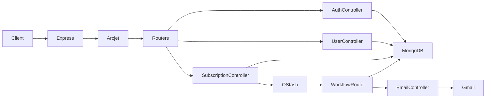

# SubDub Subscription Tracker API

SubDub is a Node.js API for user accounts and recurring-subscription records. It stores subscription details in MongoDB and uses Upstash Workflow to schedule renewal reminder emails.

## Problem and scope

Recurring services can be difficult to track in one place. This API stores each service's price, billing frequency, category, payment method, and renewal dates, then schedules reminder emails. It does not process payments, import transactions, or provide a frontend.

## What is implemented

- Account registration and sign-in using password hashing and JWT bearer tokens.
- Subscription create, list, read, update, delete, and cancel endpoints.
- Automatic renewal-date calculation when a renewal date is not provided.
- Reminder workflows scheduled for 7, 5, 2, and 1 day before renewal.
- Reminder email delivery through Nodemailer configured for Gmail.
- Arcjet request protection with shield, bot-detection, and token-bucket rules.

This project records subscriptions; it does not charge payment methods or integrate with payment processors.

## Technology

| Area | Technology |
| --- | --- |
| Runtime | Node.js (Mongoose 9 requires Node.js 20.19 or later) |
| HTTP API | Express 4 |
| Database | MongoDB with Mongoose |
| Authentication | bcryptjs and JSON Web Tokens |
| Request protection | Arcjet |
| Workflow scheduling | Upstash Workflow / QStash |
| Email | Nodemailer with Gmail transport |
| Date calculations | Day.js |

## Architecture



See [docs/ARCHITECTURE.md](docs/ARCHITECTURE.md) for request flow and component details.

## Project structure

```text
config/        Environment loading and Arcjet, Nodemailer, and Upstash clients
controllers/   Authentication, users, subscriptions, and workflow handlers
database/      MongoDB connection
middlewares/   JWT authorization, Arcjet protection, and error responses
models/        Mongoose user and subscription schemas
routes/        Express route definitions
utils/         Reminder email generation and delivery
docs/          Architecture, API, database, testing, and review documentation
postman/       Importable collection and safe environment template
tests/         Isolated HTTP and model-validation tests
```

## Prerequisites

- Node.js 20.19 or later and npm.
- A MongoDB replica set (registration uses a transaction; a standalone `mongod` is insufficient).
- Arcjet credentials for the configured request-protection middleware.
- An Upstash QStash endpoint and token for subscription workflows.
- A publicly reachable API base URL for QStash callbacks outside local-only testing.
- Gmail credentials suitable for Nodemailer (use an app password where required).

## Local setup

1. Install the locked dependencies:

   ```sh
   npm ci
   ```

2. Copy `.env.example` to `.env.development.local` and fill in values locally. The local env file is ignored by Git.

3. Ensure a MongoDB replica set is available and the `DB_URI` value points to an isolated development database. MongoDB Atlas is also suitable.

4. Configure QStash. `QSTASH_URL` must point to a reachable QStash service; `127.0.0.1:8080` only works if a local QStash service is running there. `SERVER_URL` must be the API's public base URL so QStash can call the workflow endpoint.

5. Start the API:

   ```sh
   npm run dev
   ```

   `PORT` has no source-code default; set it in the environment. The root endpoint is `GET /`.

The application loads `.env.<NODE_ENV>.local`, defaulting to `.env.development.local` when `NODE_ENV` is unset. `SERVER_URL` is the canonical workflow callback variable; the current code also accepts the legacy `SERVER_URl` spelling.

See [docs/TECHNICAL_OVERVIEW.md](docs/TECHNICAL_OVERVIEW.md) for environment and integration details.

## Backend concepts

- Express routers and middleware separate request matching, authorization, protection, and error handling.
- Mongoose schemas provide validation, timestamps, indexes, a user reference, and a subscription save hook.
- Registration hashes passwords and uses a MongoDB transaction; JWTs authenticate subsequent requests.
- QStash runs durable delayed reminder steps; Nodemailer sends the reminder messages.

## Database overview

MongoDB stores `User` and `Subscription` documents. A subscription references its owner by ObjectId; renewal date is calculated using fixed day intervals if omitted. See [docs/DATABASE.md](docs/DATABASE.md) for all fields and validation behavior.

## API and Postman

API routes are mounted under `/api/v1`. Import:

- [Postman collection](postman/subscription-tracker.postman_collection.json)
- [Postman environment template](postman/subscription-tracker.postman_environment.json)

Set `baseUrl` in the environment to the API origin, then sign in or sign up to populate the bearer token. Read [docs/API_DOCUMENTATION.md](docs/API_DOCUMENTATION.md) before testing: it describes incomplete routes and known route/security issues. Do not run destructive requests against production or real user data.

## Authentication and security

Registration hashes passwords with bcryptjs; sign-in returns a JWT used as a bearer token. Arcjet is configured for shield and rate-limit checks. The current implementation also has documented security issues, including endpoints that expose password hashes; review [docs/SECURITY_REVIEW.md](docs/SECURITY_REVIEW.md) before using or publishing this API with real user data.

## Testing and quality checks

The automated API tests use Node's built-in test runner and Supertest. Persistence and QStash are mocked so the suite does not connect to a database or external service.

```sh
npm test
```

Run the existing lint check with:

```sh
npm run lint
```

See [docs/TESTING.md](docs/TESTING.md) for coverage and limitations. The Arcjet service itself is not contacted or exercised by the isolated HTTP test harness.

## Known limitations

- `POST /api/v1/auth/sign-out` has an empty handler and does not send a response.
- Several `/api/v1/users` write routes are placeholders.
- `GET /api/v1/subscriptions/upcoming-renewals` is shadowed by the earlier `/:id` route and does not return upcoming renewals.
- Subscription creation saves the record before contacting QStash. If that network request fails, the record remains in MongoDB while the API returns an error.
- The public `GET /api/v1/users` response includes full user documents, including password hashes; registration also returns the created user document. Avoid using real accounts with these endpoints until corrected.
- The production dependency audit reports known vulnerabilities; see [docs/SECURITY_REVIEW.md](docs/SECURITY_REVIEW.md) before publishing.

The read-only findings are in [docs/SECURITY_REVIEW.md](docs/SECURITY_REVIEW.md); schema details are in [docs/DATABASE.md](docs/DATABASE.md).

## Future improvements

- Remove password hashes from every API response and enforce user ownership on profile routes.
- Implement sign-out/token revocation and replace placeholder user/upcoming-renewal routes.
- Make subscription updates and reminder scheduling idempotent and consistent.
- Resolve dependency audit findings and expand tests for live integration boundaries.

## Suggested GitHub repository description

> Express and MongoDB API for tracking recurring subscriptions, with JWT authentication and QStash-powered renewal reminder workflows.
