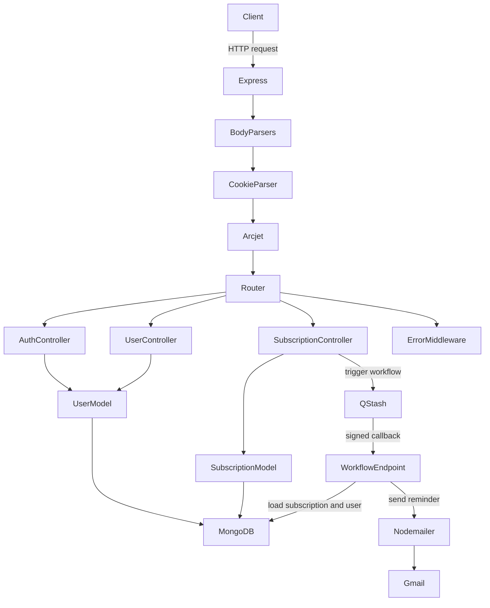
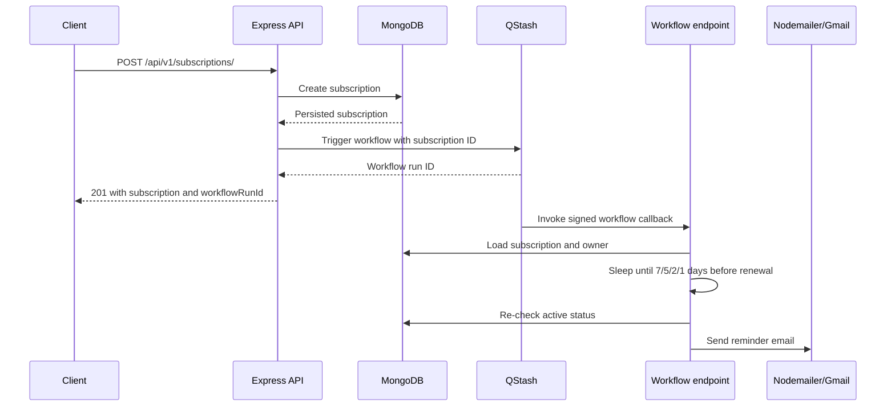

# Architecture

## System overview

The application is a single-process Express API. Express parses request bodies and cookies, applies Arcjet protection, dispatches requests to routers, and passes controller errors to a central error handler. Controllers use Mongoose models for MongoDB access. Subscription creation also publishes a workflow invocation to QStash. The workflow endpoint reads the subscription and sends scheduled reminder emails.



## Components

| Component | Responsibility |
| --- | --- |
| `app.js` | Creates the Express app, configures proxy trust and request middleware, mounts routers, and starts the HTTP listener and MongoDB connection. |
| `config/env.js` | Loads `.env.<NODE_ENV>.local` (development by default) and exposes application settings. |
| `config/arcjet.js` | Configures shield, bot detection, and token-bucket rules. |
| `config/upstash.js` | Creates the reusable Upstash Workflow client from QStash settings. |
| `config/nodemailer.js` | Creates the Gmail Nodemailer transport. |
| `database/mongodb.js` | Connects Mongoose to MongoDB. |
| `routes/` | Maps URL paths and HTTP methods to middleware and controllers. |
| `controllers/` | Performs request-level logic and database operations. |
| `models/` | Defines Mongoose schemas, validation, indexes, and subscription save behavior. |
| `middlewares/auth.middleware.js` | Extracts and verifies bearer JWTs, then loads the authenticated user. |
| `middlewares/arcjet.middleware.js` | Applies Arcjet protection before route handling. |
| `middlewares/error.middleware.js` | Logs errors and maps known Mongoose errors to JSON responses. |
| `controllers/workflow.controller.js` | Runs reminder steps using the Upstash Workflow context. |
| `utils/` | Builds reminder email HTML and sends messages through Nodemailer. |

## Request and error lifecycle

1. `express.json()`, `express.urlencoded()`, and `cookieParser()` run.
2. Arcjet checks the request. Denied requests receive a 403 or 429 response.
3. Express matches a mounted router and route.
4. Protected routes run JWT authorization before the controller.
5. Controllers query or mutate MongoDB using Mongoose.
6. A thrown/rejected controller error is passed to the final error middleware.
7. The error middleware logs the error and returns `{ "success": false, "error": "..." }`.

The error middleware recognizes Mongoose cast, duplicate-key, and validation errors. It reads `statusCode`; errors that set only `status` fall through to status 500.

## Authentication

Registration checks for an existing email, hashes the password with bcryptjs, creates the user in a Mongoose transaction, and returns a JWT. Sign-in checks the password hash and returns a JWT. Protected routes expect:

```http
Authorization: Bearer <jwt>
```

The authorization middleware verifies the token with `JWT_SECRET`, loads the user, and attaches it to `req.user`.

## Subscription and reminder flow



Subscription persistence and QStash publishing are separate operations. If publishing fails after persistence, the controller returns an error but does not roll back the saved subscription.

The workflow handler uses `context.run()` for database/email steps and `context.sleepUntil()` for scheduled waits. It checks that the subscription remains active before sending a reminder.

## Middleware ordering and limitations

Arcjet is mounted before the application routers. Route-level JWT authorization is applied only where explicitly registered; some user routes are public or placeholders. The workflow route is wrapped with Upstash's `serve` handler, which performs QStash verification when its signing keys are configured.

`app.listen()` starts the listener before awaiting `connectToDatabase()` inside the listener callback. Consequently, the port can begin accepting requests before MongoDB connection setup has completed.
